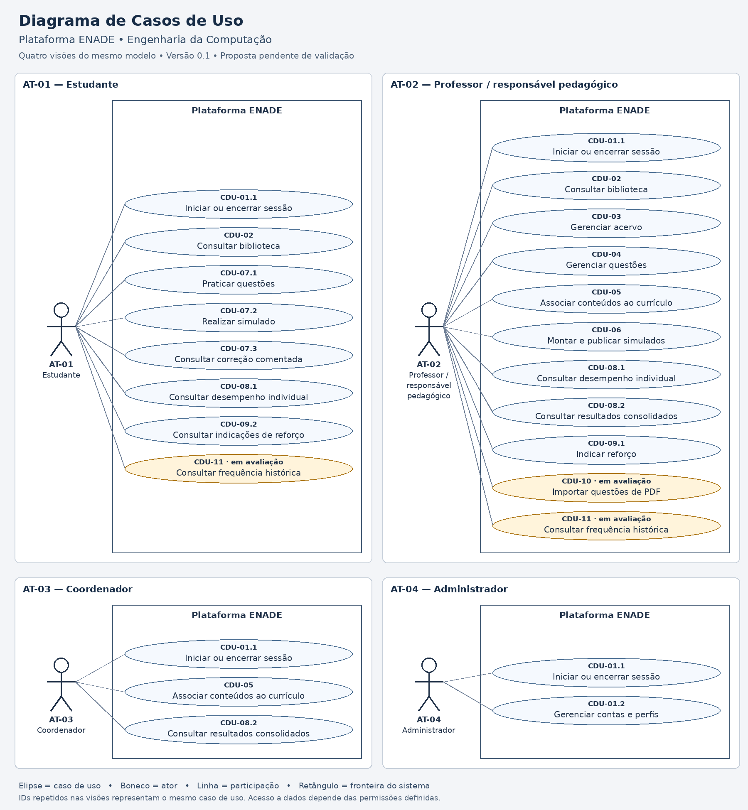

# Diagrama de Casos de Uso

**Projeto:** Plataforma de Gestão do Conhecimento e Aprendizagem ENADE — Engenharia da Computação  
**Versão:** 0.1 — 01/11/2026  
**Situação:** modelagem inicial baseada em requisitos propostos; revisão do grupo e validação com interessados pendentes.  
**Elaboração:** grupo do projeto — nomes a preencher.

## 1. Diagrama

A imagem apresenta quatro visões do mesmo modelo, com associações filtradas por ator para facilitar a leitura. Cada retângulo representa a mesma plataforma, não quatro sistemas ou componentes. Casos com o mesmo ID são o mesmo elemento, mesmo quando aparecem em várias visões.

[Imagem em resolução completa](casos-uso.png) · [Fonte editável em PlantUML](casos-uso.puml)

A fonte PlantUML contém o modelo completo com os quatro atores, os mesmos casos e todas as associações da imagem. Seu arranjo visual ao renderizar pode diferir das quatro visões da imagem. Manter os três arquivos na mesma pasta do repositório para preservar estes links.

## 2. Atores

| ID | Ator | Participação e limites |
| --- | --- | --- |
| AT-01 | Estudante | Consulta materiais, pratica questões, realiza simulados e consulta os próprios resultados e indicações de reforço |
| AT-02 | Professor ou responsável pedagógico | Gerencia conteúdos e avaliações, acompanha estudantes autorizados e indica reforço |
| AT-03 | Coordenador | Associa conteúdos ao currículo e consulta resultados consolidados; não recebe automaticamente acesso a resultados individuais |
| AT-04 | Administrador | Administra contas e perfis; sua função técnica não concede acesso pedagógico irrestrito |

Os atores correspondem à seção 5 da [Visão da Demanda](visao-demanda-enade-computacao.md). Uma pessoa pode desempenhar mais de um papel se autorizada, mas não foi presumida herança de permissões entre os perfis.

## 3. Casos de uso e rastreabilidade

Os grupos CDU-01 a CDU-11 foram reservados na visão. Sufixos identificam desdobramentos necessários para representar objetivos diferentes, preservando o vínculo com esses grupos. Esta é uma modelagem inicial; o catálogo não substitui especificações completas de fluxos, precondições e exceções.

| ID | Caso de uso | Atores | RF | Funcionalidade | Backlog |
| --- | --- | --- | --- | --- | --- |
| CDU-01.1 | Iniciar ou encerrar sessão | AT-01, AT-02, AT-03, AT-04 | RF-01 | F-01 | BP-01 |
| CDU-01.2 | Gerenciar contas e perfis | AT-04 | RF-02 | F-01 | BP-01 |
| CDU-02 | Consultar biblioteca | AT-01, AT-02 | RF-03, RF-04 | F-02 | BP-03 |
| CDU-03 | Gerenciar acervo | AT-02 | RF-05 | F-03 | BP-02 |
| CDU-04 | Gerenciar questões | AT-02 | RF-06 | F-04 | BP-04 |
| CDU-05 | Associar conteúdos ao currículo | AT-02, AT-03 | RF-07 | F-05 | BP-10 |
| CDU-06 | Montar e publicar simulados | AT-02 | RF-08 | F-06 | BP-06 |
| CDU-07.1 | Praticar questões | AT-01 | RF-17 | F-07 | BP-05 |
| CDU-07.2 | Realizar simulado | AT-01 | RF-09, RF-10 | F-07 | BP-07 |
| CDU-07.3 | Consultar correção comentada | AT-01 | RF-11 | F-07 | BP-07 |
| CDU-08.1 | Consultar desempenho individual | AT-01, AT-02 | RF-12 | F-08 | BP-08 |
| CDU-08.2 | Consultar resultados consolidados | AT-02, AT-03 | RF-13 | F-08 | BP-09 |
| CDU-09.1 | Indicar reforço | AT-02 | RF-14 | F-09 | BP-11 |
| CDU-09.2 | Consultar indicações de reforço | AT-01 | RF-14 | F-09 | BP-11 |
| CDU-10 | Importar questões de PDF | AT-02 | RF-15 | F-10 | BP-12 |
| CDU-11 | Consultar frequência histórica | AT-01, AT-02 | RF-16 | F-11 | BP-13 |

Referências: [Requisitos funcionais](requisitos-funcionais.md), [Regras de negócio](regras-negocio.md), [Requisitos não funcionais](requisitos-nao-funcionais.md) e [Backlog priorizado](backlog-priorizado.md).

## 4. Interpretação do modelo

- **Iniciar ou encerrar sessão** reúne as ações de acesso previstas em RF-01. Estar autenticado e autorizado é precondição das operações restritas; não se repete autenticação como `include` em todas as operações.
- **Gerenciar acervo** e **Gerenciar questões** abrangem cadastro, edição, revisão, publicação e retirada. O detalhamento deve respeitar revisão e versionamento previstos nas regras; associação do professor não significa que toda pessoa com esse perfil possa aprovar qualquer conteúdo sem restrições.
- **Consultar biblioteca** abrange busca, filtros, detalhes e abertura de materiais. A disponibilidade dos filtros curriculares depende da classificação definida em CDU-05.
- **Realizar simulado** abrange responder, salvar, finalizar e receber a correção calculada internamente. O encerramento por término do tempo é comportamento interno; o relógio ou o próprio sistema não é desenhado como ator externo.
- **Consultar correção comentada** é objetivo separado: depende da liberação do gabarito e permite rever respostas e comentários da tentativa. Não significa que o gabarito esteja disponível durante a prova.
- **Consultar desempenho individual** permite ao estudante consultar seus dados e ao professor consultar somente estudantes autorizados. O relatório consolidado segue as regras específicas de acesso e cálculo.
- **Indicar reforço** e **Consultar indicações de reforço** são objetivos de atores diferentes que detalham RF-14. A proposta não pressupõe recomendação automática.
- **Importar questões de PDF** gera rascunhos que precisam de conferência e revisão. A publicação é uma ação posterior; não foi modelada como uma etapa obrigatória da importação.
- **Consultar frequência histórica** depende do conjunto de provas e do método de contagem. Assim como a importação, está em avaliação, e não representa capacidade já aprovada.

As linhas são associações UML de participação, sem direção de fluxo ou ordem de execução. Não foram adicionados relacionamentos `include` ou `extend` sem um comportamento compartilhado obrigatório ou extensão condicional suficientemente especificados. A ausência desses relacionamentos não impede a modelagem dos objetivos atuais.

## 5. Fronteira do sistema

PreparaEdu, plataforma de questões da Unifor e portal do INEP não aparecem como atores: não há interação técnica direta confirmada. Uma prova do INEP enviada em PDF é um documento de entrada, não um ator. Links para materiais externos também não estabelecem, por si, integração entre sistemas.

O grupo do projeto e o professor da disciplina são stakeholders da atividade acadêmica; não foram criados perfis operacionais para eles apenas por essa condição. Não há casos de gestão administrativa de inscrições do ENADE, outros cursos ou correção automática de discursivas no recorte atual.

## 6. Pendências de validação

- Confirmar representantes, permissões e eventual acumulação de papéis.
- Confirmar publicação e revisão de questões e materiais, incluindo quem pode aprovar.
- Definir políticas de tentativas, duração, interrupção e liberação de gabarito.
- Validar cálculo, quantidade suficiente de questões e interpretação dos resultados.
- Decidir a inclusão de importação de PDF e frequência histórica.
- Revisar o diagrama com o grupo e confrontá-lo com os resultados reais das entrevistas.

## 7. Verificação desta versão

Foram conferidas a cobertura dos RF-01 a RF-17, a consistência entre associações da imagem e da fonte e as referências aos atores da visão. Isso não constitui validação com usuários nem execução de testes da futura plataforma. As imagens e a fonte editável devem ser atualizadas juntas quando o modelo mudar.

| Data | Versão | Alteração | Responsável |
| --- | --- | --- | --- |
| 01/11/2026 | 0.1 | Modelo inicial com quatro atores e 16 casos de uso; visões por ator e fonte PlantUML | Grupo — nomes a preencher |
