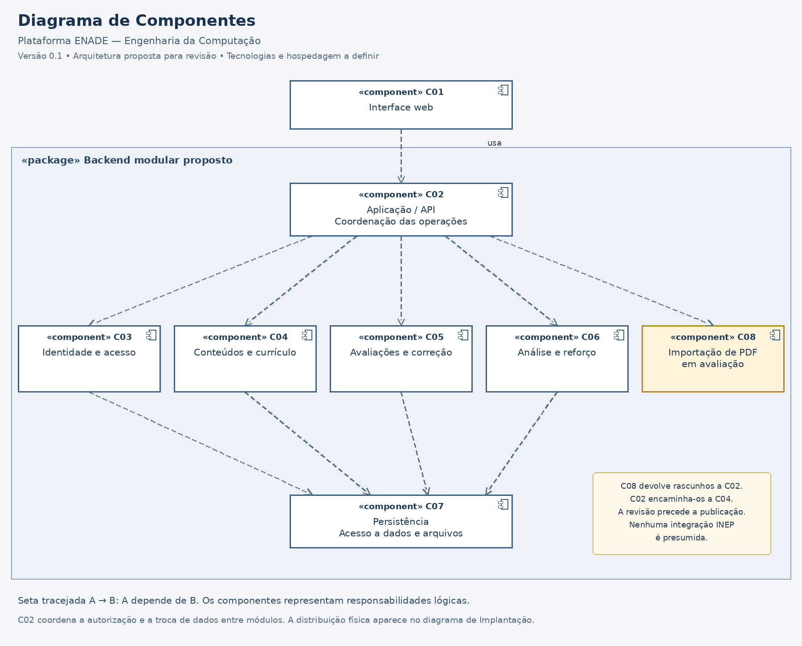

# Diagrama de Componentes

**Projeto:** Plataforma de Gestão do Conhecimento e Aprendizagem ENADE — Engenharia da Computação  
**Versão:** 0.1 — 01/11/2026  
**Situação:** proposta de arquitetura inicial; validação técnica e pedagógica pendente.  
**Elaboração:** grupo do projeto — nomes a preencher.

## 1. Modelo proposto

[Imagem em resolução completa](componentes.png) · [Fonte editável em PlantUML](componentes.puml)

A proposta organiza a solução em interface web e backend modular, com uma aplicação no servidor reunindo as responsabilidades de acesso, conteúdo, avaliação, análise e persistência. É uma hipótese adequada à modelagem inicial, sujeita à revisão conforme carga, equipe e ambiente. Os componentes não são serviços independentes obrigatórios nem servidores físicos.

## 2. Responsabilidades e rastreabilidade

| ID | Componente | Responsabilidade | RF e casos de uso relacionados |
| --- | --- | --- | --- |
| C01 | Interface web | Apresentar telas, capturar ações e exibir respostas; não decide sozinha autorização ou correção | Todos os fluxos dos RF-01 a RF-17; casos descritos em casos-uso.md |
| C02 | Aplicação / API | Receber operações, consultar autorização e coordenar módulos e respostas | Todos os RF; suporte transversal aos casos de uso |
| C03 | Identidade e acesso | Autenticação, sessão, contas, perfis e decisões de autorização | RF-01, RF-02; CDU-01.1, CDU-01.2; RNF-01, RNF-02 |
| C04 | Conteúdos e currículo | Biblioteca, materiais, questões, revisão, versões, temas e associações curriculares | RF-03, RF-04, RF-05, RF-06, RF-07; CDU-02 a CDU-05; RNF-07 |
| C05 | Avaliações e correção | Prática, configuração de simulados, tentativas, respostas, encerramento, correção e liberação de gabarito | RF-08, RF-09, RF-10, RF-11, RF-17; CDU-06, CDU-07.1 a CDU-07.3; RNF-06 |
| C06 | Análise e reforço | Indicadores individuais e consolidados, orientações de reforço e frequência histórica quando aprovada | RF-12, RF-13, RF-14, RF-16; CDU-08.1, CDU-08.2, CDU-09.1, CDU-09.2, CDU-11 |
| C07 | Persistência | Operações de leitura e gravação de dados e arquivos; suporte a transações e preservação de versões | Suporte aos RF que mantêm dados; RNF-06, RNF-07, RNF-09, RNF-10 |
| C08 | Importação de PDF — em avaliação | Extrair conteúdo de PDF e retornar rascunhos e falhas detectadas, sem publicar questões | RF-15; CDU-10; BP-12 |

A frequência histórica de C06 continua em avaliação (BP-13), embora o componente também execute funções do núcleo. A presença de C08 no desenho não representa aprovação de sua implementação.

## 3. Dependências e serviços lógicos

Setas tracejadas representam dependência UML: o componente na origem utiliza o destino. As dependências podem ocorrer entre módulos do mesmo processo; não implicam chamadas de rede. A02 no diagrama de implantação reúne C02 a C07, com C08 condicionado à aprovação.

| Origem | Destino | Serviço utilizado |
| --- | --- | --- |
| C01 | C02 | Operações de consulta, gestão, avaliação e acompanhamento |
| C02 | C03 | Sessão, contas, perfis e autorização |
| C02 | C04 | Consulta e gestão de conteúdo, versões e classificação |
| C02 | C05 | Prática, simulados, tentativas e correção |
| C02 | C06 | Indicadores e indicações de reforço |
| C02 | C08 | Extração assistida de PDF, se aprovada |
| C03 | C07 | Persistência dos dados de identidade e acesso |
| C04 | C07 | Persistência do catálogo, questões, versões, classificação e arquivos |
| C05 | C07 | Persistência dos simulados, tentativas e respostas |
| C06 | C07 | Persistência das indicações e consulta dos registros de análise autorizados |

C02 passa aos módulos os dados necessários às operações. Por exemplo, obtém versões de questões em C04 e solicita a aplicação/correção a C05; reúne resultados e classificações para C06. O desenho não pressupõe chamadas diretas entre esses módulos. C08 devolve a extração a C02, que encaminha rascunhos a C04 para manutenção e revisão posterior.

Estes serviços são contratos lógicos preliminares; formatos de mensagens, assinaturas e protocolos ainda não foram definidos. Não foi criado um endpoint, API institucional ou fornecedor fictício.

## 4. Decisões e limites

- Acesso web e backend modular constituem propostas técnicas desta versão, sem escolha de linguagem ou framework.
- C02 deve aplicar a autorização de cada operação restrita e delimitar o conjunto de dados; ocultar botões em C01 não basta.
- A regra de cálculo e a preservação da versão aplicada são responsabilidades de domínio, apoiadas pela persistência. A nota da plataforma não equivale à nota oficial do ENADE.
- O tempo da tentativa deve ser controlado no servidor. O mecanismo de encerramento, inclusive quando o navegador é fechado, precisa ser detalhado; o desenho não pressupõe um serviço externo de agendamento.
- O envio de respostas precisa distinguir dados enviados de dados confirmados como salvos, mantendo a condição de integridade definida em RNF-06.
- C07 é um componente de software, não o banco físico. O banco e os arquivos aparecem como recursos de implantação no documento correspondente.
- Armazenar conteúdo e classificar questões não substitui revisão humana, comprovação de origem e verificação das condições de uso.
- Não há integração direta confirmada com PreparaEdu, plataforma da Unifor ou INEP.

## 5. Verificação e validação pendente

A imagem foi conferida visualmente e as dependências da imagem correspondem à fonte PlantUML. Os RF-01 a RF-17 têm responsabilidades atribuídas. Essa conferência documental não comprova desempenho, segurança ou viabilidade operacional.

Ainda é necessário validar matriz de acesso, classificação, carga, armazenamento, limites da importação e parâmetros dos RNF incompletos. Casos de uso e contratos deverão detalhar exceções, autorização por recurso e preservação dos resultados históricos.

## 6. Referências

- [Casos de Uso](casos-uso.md).
- [Requisitos funcionais](requisitos-funcionais.md).
- [Requisitos não funcionais](requisitos-nao-funcionais.md).
- [Regras de negócio](regras-negocio.md).
- [Backlog](backlog-priorizado.md).
- [Implantação proposta](implantacao.md).

| Data | Versão | Alteração | Responsável |
| --- | --- | --- | --- |
| 01/11/2026 | 0.1 | Proposta de componentes, dependências e responsabilidades | Grupo — nomes a preencher |
