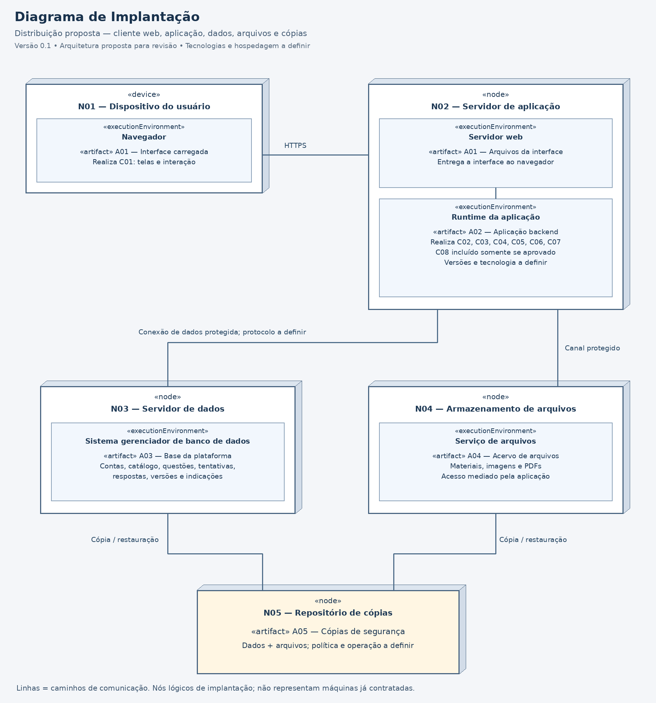

# Diagrama de Implantação

**Projeto:** Plataforma de Gestão do Conhecimento e Aprendizagem ENADE — Engenharia da Computação  
**Versão:** 0.1 — 01/11/2026  
**Situação:** proposta de arquitetura inicial; validação técnica e pedagógica pendente.  
**Elaboração:** grupo do projeto — nomes a preencher.

## 1. Modelo proposto

[Imagem em resolução completa](implantacao.png) · [Fonte editável em PlantUML](implantacao.puml)

O desenho propõe acesso pelo navegador, uma aplicação no servidor e recursos separados para dados, arquivos e cópias de segurança. Os nós representam papéis de implantação, que podem corresponder a máquinas virtuais ou serviços gerenciados. Não há provedor contratado, endereço de rede, tecnologia de banco ou capacidade de hardware definida.

## 2. Nós, ambientes e artefatos

| Nó | Ambiente de execução | Artefato hospedado ou executado | Relação com componentes |
| --- | --- | --- | --- |
| N01 — Dispositivo do usuário | Navegador | A01 — interface carregada no cliente | Realiza C01 e comunica ações a C02 |
| N02 — Servidor de aplicação | Servidor web e runtime de aplicação | A01 — arquivos de interface; A02 — aplicação backend | A01 realiza C01; A02 realiza C02, C03, C04, C05, C06 e C07; C08 somente se aprovado |
| N03 — Servidor de dados | Sistema gerenciador de banco de dados | A03 — base de dados da plataforma | Recurso acessado pelo componente C07 |
| N04 — Armazenamento de arquivos | Serviço de arquivos | A04 — materiais, imagens e PDFs | Recurso acessado pelo componente C07 |
| N05 — Repositório de cópias | Ambiente operacional a definir | A05 — cópias de dados e arquivos | Suporte à recuperação prevista em RNF-09; não é componente de negócio |

A01 aparece no servidor como arquivos entregues ao navegador e no dispositivo como a interface carregada. Não são duas interfaces distintas. A02 é uma unidade de implantação proposta: seus módulos lógicos não precisam de um servidor separado para cada componente.

A03 mantém contas, perfis, metadados do acervo, questões, classificação, versões, simulados, tentativas, respostas e indicações. A04 guarda os arquivos binários, quando houver autorização para hospedá-los; recursos externos referenciados por link não precisam ser copiados. A05 depende de uma política consistente de cópia e restauração de A03 e A04.

## 3. Caminhos de comunicação

| Origem e destino | Caminho proposto | Finalidade e restrição |
| --- | --- | --- |
| N01 e N02 | HTTPS | Entregar a interface e transmitir operações e resultados; autenticação e autorização aplicadas pelo servidor |
| Servidor web e runtime em N02 | Encaminhamento interno | Receber e encaminhar operações à aplicação; mecanismo a definir |
| N02 e N03 | Conexão de dados protegida; protocolo a definir | Ler e gravar dados estruturados pela persistência; sem acesso direto do navegador |
| N02 e N04 | Canal protegido; protocolo a definir | Ler e gravar arquivos por operações autorizadas; não publicar o acervo inteiro indiscriminadamente |
| N03 e N05 | Cópia e restauração; procedimento a definir | Recuperar a base conforme política validada |
| N04 e N05 | Cópia e restauração; procedimento a definir | Recuperar os arquivos em conjunto com as referências da base |

As linhas representam caminhos de comunicação, não sequência temporal nem indicação de quem inicia a conexão. O agente ou mecanismo de cópia ainda não foi definido. N05 é um destino proposto de recuperação, não evidência de que cópias já existam.

## 4. Condições de operação

- N03 e N04 devem ter acesso limitado aos serviços e responsáveis autorizados; não há caminho direto do dispositivo do usuário a esses nós no modelo.
- Credenciais e dados de sessão não devem ser expostos em páginas ou registros; a definição dos mecanismos técnicos depende de RNF-02 e da revisão de segurança.
- O componente C05, em A02, deve controlar as condições de tentativa e correção; o navegador não é fonte confiável para autorizar tempo adicional ou alterar resultado.
- N02 é apresentado como uma instância lógica. O desenho não comprova alta disponibilidade e não inclui redundância já dimensionada.
- Recursos, carga simultânea e metas de resposta precisam ser levantados antes de escolher tamanhos de instância ou estratégias de escalabilidade (RNF-08).
- Janela de operação, tempo de recuperação, perda máxima tolerável, retenção e frequência das cópias permanecem pendentes (RNF-09 e RNF-10).
- A eventual extração de PDFs fica inicialmente em A02, com C08 condicionado à viabilidade. Se a carga exigir isolamento ou processamento separado, revisar os dois diagramas antes de alterar a implantação.
- INEP, PreparaEdu e plataformas da Unifor não são nós conectados porque não há integração confirmada.

## 5. Decisões pendentes

| Assunto | Próxima definição | Consultar |
| --- | --- | --- |
| Ambiente e tecnologias | Provedor, hospedagem, runtime, servidor web e SGBD | Grupo e STK-04 |
| Capacidade | Quantidade de usuários, volume de dados e limites de arquivo | STK-02, STK-04, STK-05 |
| Recuperação | Responsáveis, mecanismo, frequência, retenção e restauração de cópias | STK-03 e STK-04 |
| Acesso | Perfis, permissões, configuração dos canais e administração dos nós | STK-03 e STK-04 |
| Importação | Custo de extração, tipos de PDF e necessidade de isolamento | STK-02, STK-04, STK-05 |

## 6. Verificação documental

Foram conferidas a correspondência entre C01–C08 e A01–A02, a distinção entre componentes lógicos e recursos de implantação, os caminhos de comunicação e a legibilidade da imagem. A fonte PlantUML apresenta os mesmos nós e caminhos, com layout que pode variar ao renderizar. Não houve implantação real nem teste operacional.

## 7. Referências

- [Componentes](componentes.md).
- [Requisitos não funcionais](requisitos-nao-funcionais.md).
- [Requisitos funcionais](requisitos-funcionais.md).
- [Visão da Demanda](visao-demanda-enade-computacao.md).
- [Backlog](backlog-priorizado.md).

| Data | Versão | Alteração | Responsável |
| --- | --- | --- | --- |
| 01/11/2026 | 0.1 | Proposta de nós, ambientes, artefatos e caminhos de comunicação | Grupo — nomes a preencher |
